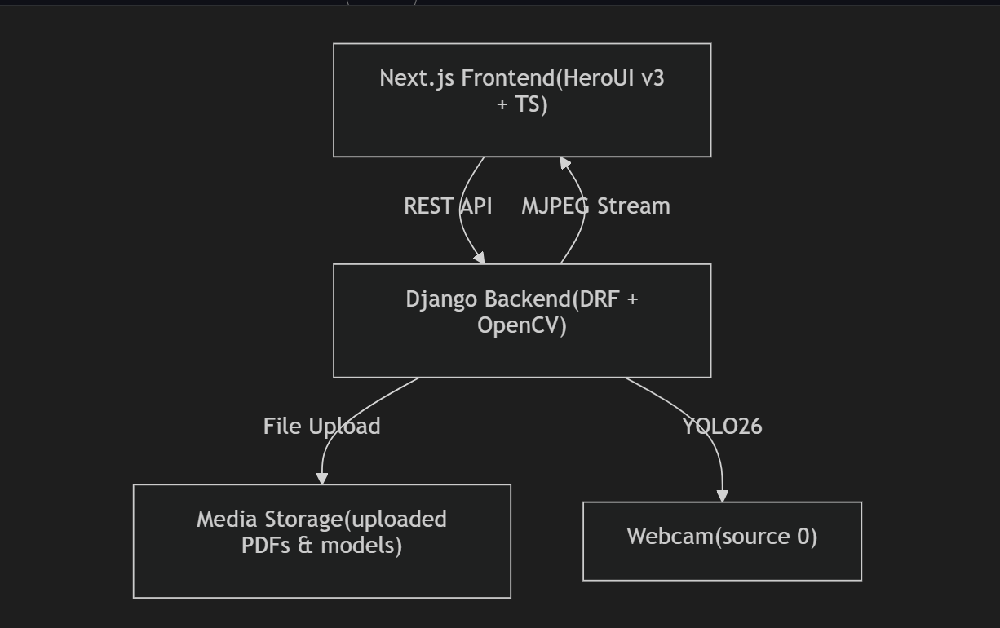

# 👁️ OmniSight

<div align="center">

**Gerçek Zamanlı YOLO Tespit Paneli** — PPE tespiti, araç hasarı segmentasyonu ve canlı insan sayma

[](https://python.org)
[](https://djangoproject.com)
[](https://nextjs.org)
[](https://docs.ultralytics.com)
[](https://mongodb.com)

</div>

<div align="center">
  
</div>

---

## 📖 İçindekiler

- [Hakkında](#-hakkında)
- [Özellikler](#-özellikler)
- [Modüller](#-modüller)
- [Mimari](#️-mimari)
- [Teknoloji Yığını](#-teknoloji-yığını)
- [Kurulum](#️-kurulum)
- [Kullanım](#-kullanım)
- [API Referansı](#-api-referansı)
- [Proje Yapısı](#-proje-yapısı)
- [Yapanlar](#-yapanlar)

---

## 💡 Hakkında

**OmniSight**, *Yapay Sinir Ağları ve Derin Öğrenme* dersi için geliştirilmiş bir ders projesidir.
Şunları sağlar:

- 📸 **Görüntü yükleyerek** anlık YOLO tespiti ve segmentasyonu
- 🎥 **Webcam üzerinden WebSocket** ile gerçek zamanlı (canlı) tespit — WebSocket asenkron, model çıkarımı thread havuzunda çalışır
- 📊 **Üç ayrı model modülü** tek bir modern dashboard üzerinden yönetilir
- ☁️ İsteğe bağlı **Roboflow Serverless API** desteği ile bulutta çıkarım

| Modül | Model | Görev | Canlı? |
|:---|:---|:---|:---:|
| 🛡️ **PPE (KKD) Tespiti** | `ppe.pt` (YOLO) | Baret, yelek, maske vb. tespiti | ✅ |
| 🚗 **Araç Hasarı Segmentasyonu** | `car_damage.pt` (YOLO11l / RF-DETR) | Araç hasar alanlarını maskeleme | ✅ |
| 👥 **İnsan Sayma** | `yolo26n.pt` (YOLO26) | Webcam'den kişi tespiti + sayaç | ✅ |

---

## ✨ Özellikler

- 🎨 **Glass-morphism Dashboard** — HeroUI v3 + Tailwind CSS 4 ile modern, animasyonlu arayüz
- ⚡ **Önbellekli Model Yükleme** — modeller sunucu açılışında preload edilir, ilk kare gecikmesi yok
- 🔀 **Asenkron Mimari** — Django Channels `AsyncWebsocketConsumer`, çıkarım `asyncio.to_thread` ile event loop'u bloklamaz
- 🖼️ **Özel Görselleştirme** — sınıf renk paleti, dinamik font ölçekleme ve düzenli etiket kutuları
- 🗄️ **MongoDB Kayıt** — PDF ve model yüklemeleri veritabanına kaydedilir
- 📄 **PDF & Model Yükleme** — ödev raporları ve `.pt` modelleri doğrudan panelden yüklenebilir

---

## 🧩 Modüller

### 🛡️ Ödev 1 — PPE (Kişisel Koruyucu Ekipman) Tespiti

YOLO tabanlı nesne tespiti ile baret, yelek, bot, eldiven, güvenlik gözlüğü ve maske tespiti.
Her sınıf için özel renk paleti ve güven skoru etiketleri. PDF rapor + `best.pt` model yükleme desteği.

> **Etiketler:** Object Detection • PPE • YOLO

### 🚗 Ödev 2 — Araç Hasarı Segmentasyonu

YOLO11l ve RF-DETR modellerinin karşılaştırması ile araç hasar tespiti.
Instance segmentation maskeleri kutusuz olarak çizilir; model `.pt` olarak yüklenebilir.

> **Etiketler:** Instance Segmentation • YOLO11l • RF-DETR

### 👥 People Counter — YOLO26 ile İnsan Sayma

Webcam'den canlı video akışında kişi tespiti ve sayımı. WebSocket (`ws://`) üzerinden
kare bazlı çıkarım; toplam kişi sayısı görüntü üzerine yerleştirilir.

> **Etiketler:** YOLO26 • Real-time • Webcam

---

## 🏗️ Mimari

```text
┌─────────────────────────────┐         ┌──────────────────────────────────┐
│  Frontend (Next.js 16)      │  HTTP   │   Backend (Django 5 + DRF)       │
│  ──────────────────────     │ ──────▶ │   ────────────────────────────   │
│  HeroUI v3 + Tailwind 4     │         │   api/detect/  → REST çıkarım    │
│  Görüntü / frame gönderimi  │         │   api/upload/* → PDF & model     │
│                             │         │                                  │
│         ◀──────── WS ───────┼─────────┤   Channels + Daphne (ASGI)       │
│  Annotate edilmiş görüntü + │ base64  │   ws:// → DetectConsumer         │
│  detections JSON            │  JPEG   │   asyncio.to_thread → YOLO       │
└─────────────────────────────┘         └─────────────┬────────────────────┘
                                                      │
                                        ┌─────────────┼─────────────┐
                                        ▼             ▼             ▼
                                   🧠 YOLO .pt   🍃 MongoDB    ☁️ Roboflow
                                   (preload +   (upload       Serverless
                                    cache)       kayıtları)    (opsiyon)
```

**Veri akışı (WebSocket modu):**

1. Tarayıcı webcam karesini `image_b64` olarak JSON ile gönderir (`req_id` eşleşmesi için eklenir)
2. `DetectConsumer` kareyi thread'de çözer, önbellekli `YOLO` modelini kullanır
3. Çıkarım thread havuzunda çalışır → event loop, diğer istemcilere cevap vermeye devam eder
4. Annotate edilmiş JPEG (base64) + `detections` + `count` + `req_id` geri gönderilir

---

## 🛠️ Teknoloji Yığını

| Katman | Teknoloji |
|:---|:---|
| **Frontend** | [Next.js 16](https://nextjs.org), React 19, [HeroUI v3](https://heroui.com), Tailwind CSS 4, TypeScript |
| **Backend** | [Django 5](https://djangoproject.com), Django Rest Framework, [Channels 4](https://channels.readthedocs.io) + Daphne (ASGI) |
| **ML** | [Ultralytics YOLO](https://docs.ultralytics.com) (8.x / YOLO26), OpenCV, NumPy, Pillow |
| **Veritabanı** | MongoDB (PyMongo) |
| **Bulut Çıkarım** | Roboflow Serverless API (opsiyonel) |

---

## ⚙️ Kurulum

### 📋 Ön Gereksinimler

- 🐍 Python 3.10+
- ⬢ Node.js 20+
- 🍃 MongoDB (localhost veya Atlas)
- 📹 (People Counter için) Webcam erişimi

### 1️⃣ Depoyu Klonla

```bash
git clone <repo-url>
cd OmniSight
```

### 2️⃣ Backend

```bash
cd backend

# Sanal ortam oluştur ve aktive et
python3 -m venv venv
source venv/bin/activate      # macOS / Linux
# venv\Scripts\activate       # Windows

# Bağımlılıkları kur
pip install -r requirements.txt
```

`backend/config/settings.py` dosyasında şu ayarları kontrol edin:

| Ayar | Açıklama |
|:---|:---|
| `MONGO_URI`, `MONGO_DB_NAME` | MongoDB bağlantısı |
| `MODEL_PATHS` | `ppe`, `car_damage`, `peoplecounter` için `.pt` model yolları |
| `ROBOFLOW_API_KEY`, `ROBOFLOW_PPE_URL` | (opsiyonel) Roboflow çıkarımı |
| `CORS_ALLOWED_ORIGINS` | Frontend adresi (örn. `http://localhost:3000`) |

> Not: İlk `migrate` sırasında `contenttypes` kaynaklı uyarıları görebilirsiniz; bunlar zararsızdır.

### 3️⃣ Frontend

```bash
cd frontend
npm install
```

### 4️⃣ Modelleri Yerleştirin

`.pt` dosyalarını `backend/media/` altına veya `settings.py` içindeki `MODEL_PATHS` yollarına koyun:

- `ppe.pt` — PPE tespit modeli
- `car_damage.pt` — araç hasarı segmentasyon modeli
- `yolo26n.pt` — insan sayma modeli (`yolo26n.pt`)

---

## 🚀 Kullanım

### Backend'i Başlatın (ASGI — Daphne)

```bash
cd backend
daphne -p 8000 config.asgi:application
# veya geliştirme için:
python manage.py runserver --insecure
```

### Frontend'i Başlatın

```bash
cd frontend
npm run dev
```

Tarayıcıdan **<http://localhost:3000>** adresini açın 🎉

| Sayfa | Yol | Açıklama |
|:---|:---|:---|
| 🏠 Dashboard | `/` | Üç modülün kart görünümü |
| 🛡️ PPE | `/odev1` | Model karşılaştırması, PDF rapor yükleme |
| 🚗 Car Damage | `/odev2` | Segmentasyon testi & model yükleme |
| 👥 People Counter | `/peoplecounter` | Webcam ile canlı insan sayma |

---

## 📡 API Referansı

| Yöntem | Yol | Açıklama | Gövde (multipart/form-data) |
|:---:|:---|:---|:---|
| `POST` | `/api/detect/` | Tek kare çıkarım | `model_name`, `image` (veya `image_b64`), `task` (`detect` / `segment`) |
| `POST` | `/api/upload/pdf/` | PDF yükleme | `pdf`, `odev` |
| `POST` | `/api/upload/model/` | Model yükleme | `model`, `odev` |
| `WS` | `/ws/detect/` | Canlı çıkarım | `{"model_name": "...", "image_b64": "...", "req_id": n}` |

> WebSocket yanıt formatı:
>
> ```json
> {
>   "success": true,
>   "image": "data:image/jpeg;base64,...",
>   "detections": [{"class": "helmet", "confidence": 0.94}],
>   "count": 1,
>   "req_id": 42
> }
> ```

---

## 📂 Proje Yapısı

```text
OmniSight/
├── 🔸 backend/
│   ├── api/
│   │   ├── consumers.py      # WebSocket tüketici — canlı YOLO çıkarımı
│   │   ├── views.py          # REST API — detect, upload, Mongo, Roboflow
│   │   ├── routing.py        # WS route tanımları
│   │   └── urls.py           # URL yapılandırması
│   ├── config/               # Django ayarları (MODEL_PATHS, MONGO_URI…)
│   ├── media/                # Yüklenen model, PDF ve çıktı dosyaları
│   ├── manage.py
│   └── requirements.txt
│
├── 🔹 frontend/
│   ├── app/
│   │   ├── page.tsx          # Dashboard (modül kartları)
│   │   ├── odev1/            # 🛡️ PPE tespiti
│   │   ├── odev2/            # 🚗 Araç hasarı segmentasyonu
│   │   ├── peoplecounter/    # 👥 Canlı insan sayma
│   │   └── layout.tsx        # Root layout, HeroUI providers
│   ├── components/           # Paylaşılan UI bileşenleri
│   └── public/               # Statik görseller (hero.png vb.)
│
├── 🧪 test dosyaları
│   ├── TestPPE.py            # PPE tespit CLI testi
│   └── testCar.py            # Segmentasyon CLI testi
│
└── 📊 runs/                  # Eğitim/çıkarım kayıtları
```

---

## 🏆 Yapanlar

> Bu ödev, **Yasin KARAÇAM**, **Mustafa Atacan AKDEMİR** ve **Mübarek Yasin** tarafından yapılmıştır.

<div align="center">

⭐ Projeyi beğendiyseniz yıldızlamayı unutmayın!

</div>
